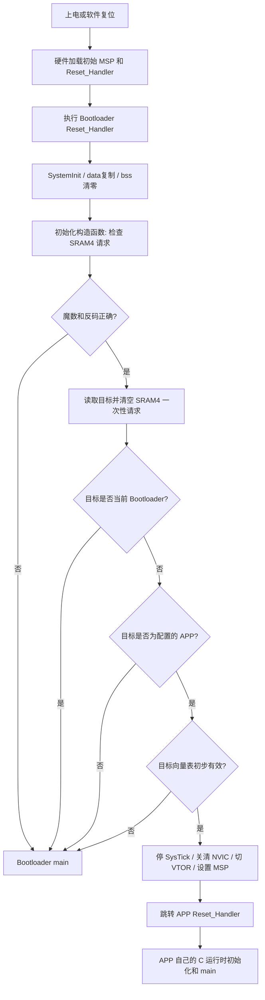

# STM32H723 Bootloader / IAP / OTA 启动、寄存器与 FreeRTOS 上下文学习仓库

> **版本：v2.0（2026-11-24，较 v1.0 新增 10 章深度解析 + 交互式离线模拟脚本）**  
> **研究对象：STM32H723VE（Cortex-M7，512 KiB 内部 Flash）**  
> **资料来源：用户原始 `MY_OTA_JUMP.c`、`MY_OTA_JUMP.h`；技术核对来源：ST RM0468、STM32H723 GCC 启动文件。**  
> **重要定位：本仓库是详细学习资料 + 原始源码留存 + 移植参考，并非开箱即用、经实机验证的完整 OTA 产品工程。**

本工程专门回答：**STM32 上电到底如何启动？为什么向量表前 8 字节如此重要？UART 中断中为何不能直接安全切程序？为什么用 SRAM4 保留跳转请求并软件复位？Bootloader、IAP、OTA 怎样组成升级闭环？**

## v2.0 新增重点：前版较简略的地方，现在深入到“CPU 怎么做”

- [12 函数指针为什么能够跳转？](docs/12_函数指针_BX_BLX与PC.md)：`typedef void (*F)(void)`、函数指针、Thumb、BL/BLX/BX、PC。
- [13 VTOR、CONTROL、MSP、BX 的严格前置条件](docs/13_跳转前的严格条件与安全顺序.md)：进入模式、权限、栈、屏蔽、异常、外设与恢复策略。
- [14 FreeRTOS PendSV 现场保存](docs/14_FreeRTOS_PendSV_现场保存条件.md)：硬件/软件压栈、TCB、R0/R2、任务 PC、FPU、优先级。
- [15 异常进入/异常返回/EXC_RETURN](docs/15_异常进入_异常返回_EXC_RETURN.md)：`0xFFFFFFFD`、SVC 如何启动第一个任务、`BX LR` 为什么恢复 PC。
- [16 原始源码逐行状态表](docs/16_原始跳转代码_逐行状态表.md)：两条跳转方向不同的控制流和各寄存器状态变化。
- [17 IAP/OTA 及掉电回滚深度设计](docs/17_OTA升级与掉电恢复_深度设计.md)：从固件打包、分包到擦写、确认、恢复与签名。
- [18 Keil/CubeIDE 实机调试与寄存器观测](docs/18_寄存器观测_实机调试.md)：断点、Disassembly、HardFault、PSP/VTOR 逐步记录。
- [19 28 道案例题与答案](docs/19_故障注入_选择题与参考答案.md)：故障注入、寄存器推断、OTA 失效模式。
- [20 ST 官方 H723 GCC 启动文件解析](docs/20_官方启动文件_逐阶段深读.md)：新增 `ExitRun0Mode`、`.init_array`、`.data/.bss`。
- [21 如何更新原有 GitHub 仓库](docs/21_GitHub更新_工程迁移与编码.md)：不删 `.git`、覆盖、提交和推送、解决乱码。

新增的离线实用工具：[`boot_flow_sim.py`](tools/boot_flow_sim.py) 模拟双向跳转、[`flash_layout.py`](tools/flash_layout.py) 验证 H723VE 扇区分区；以及 [`linker-snippets/`](linker-snippets/) 的 SRAM4 保留说明。

**阅读顺序建议：** 02 → 20 → 12 → 16 → 13 → 14 → 15 → 17 → 18 → 19。源码仍放 `original/` 原样保留，不会把“当前只有跳转”的代码误写成“OTA 已实现”。

## 0. 首先看结论

原始源码已经完成的是**两套程序在固定 Flash 地址之间的请求跳转**：

- 在 SRAM4 最后 12 字节写入 `JUMP` 魔数、目标地址与目标反码；
- `NVIC_SystemReset()` 发起**软件复位**；
- 复位从默认启动位置进入 `Reset_Handler`，在 `main()` 之前通过 `__attribute__((constructor))` 检查请求；
- 如果目标是另一个工程，则校验其向量表，调整 MSP/VTOR/NVIC 后跳往目标 `Reset_Handler`；
- 请求只处理一次，然后清空。

**它还没有实现**：固件通过 UART/USB/Wi-Fi 下载、Flash 擦写、分区镜像部署、CRC/哈希/签名验证、版本管理、失败恢复和回滚。**不能仅凭文件名 `MY_OTA_JUMP` 就称它已经实现 OTA。**

## 1. 目录导航

| 路径 | 内容 | 适合何时阅读 |
|---|---|---|
| [docs/01_概念与代码边界.md](docs/01_概念与代码边界.md) | Bootloader / IAP / OTA 定义与本工程功能边界 | 入门 |
| [docs/02_上电启动全流程.md](docs/02_上电启动全流程.md) | BOOT、向量表、MSP、Reset_Handler、SystemInit、.data/.bss、constructor、main | **重点** |
| [docs/03_源码逐函数精读.md](docs/03_源码逐函数精读.md) | 原代码逐函数精读、每个关键判断和寄存器的作用 | **重点** |
| [docs/04_双工程跳转时序.md](docs/04_双工程跳转时序.md) | Boot → APP、APP → Boot、UART 中断、复位、异常情况 | **重点** |
| [docs/05_Flash_SRAM4与链接配置.md](docs/05_Flash_SRAM4与链接配置.md) | H723VE 512 KB 实际扇区、Keil/GCC、VTOR、保留 SRAM4 | 实战 |
| [docs/06_IAP与OTA完整升级设计.md](docs/06_IAP与OTA完整升级设计.md) | 在现有跳转代码之上怎样设计真正的固件升级 | **重点** |
| [docs/07_寄存器与汇编原理.md](docs/07_寄存器与汇编原理.md) | MSP/PSP/CONTROL/IPSR/PRIMASK/BASEPRI/VTOR/NVIC/Thumb | 底层 |
| [docs/08_原代码隐患与加固建议.md](docs/08_原代码隐患与加固建议.md) | C 语言改 MSP 后继续调用、Cache、构造函数、Flash 检验 | 必读 |
| [docs/09_移植调试与测试清单.md](docs/09_移植调试与测试清单.md) | 从 CubeMX 双工程建立到实机测试的操作清单 | 实战 |
| [docs/10_面试与复习问答.md](docs/10_面试与复习问答.md) | 高频问答、故障定位、归纳 | 复习 |
| [docs/11_时序与状态图.md](docs/11_时序与状态图.md) | GitHub 支持的 Mermaid 详细可视化流程 | 画图 |
| [docs/12_函数指针_BX_BLX与PC.md](docs/12_函数指针_BX_BLX与PC.md) | 函数指针/Thumb/BLX/BX 的底层机制 | **新增重点** |
| [docs/13_跳转前的严格条件与安全顺序.md](docs/13_跳转前的严格条件与安全顺序.md) | VTOR/MSP/模式/中断的前置条件 | **新增重点** |
| [docs/14_FreeRTOS_PendSV_现场保存条件.md](docs/14_FreeRTOS_PendSV_现场保存条件.md) | RTOS 任务栈与异常现场保存 | **新增重点** |
| [docs/15_异常进入_异常返回_EXC_RETURN.md](docs/15_异常进入_异常返回_EXC_RETURN.md) | SVC/PendSV/EXC_RETURN | **新增重点** |
| [docs/16_原始跳转代码_逐行状态表.md](docs/16_原始跳转代码_逐行状态表.md) | 源码逐行 + Boot/APP 双向时序 | **新增重点** |
| [docs/17_OTA升级与掉电恢复_深度设计.md](docs/17_OTA升级与掉电恢复_深度设计.md) | 升级/掉电恢复/回滚事务设计 | **新增重点** |
| [docs/18_寄存器观测_实机调试.md](docs/18_寄存器观测_实机调试.md) | 实机寄存器与断点追踪 | **新增** |
| [docs/19_故障注入_选择题与参考答案.md](docs/19_故障注入_选择题与参考答案.md) | 28 道案例题与答案 | **新增** |
| [docs/20_官方启动文件_逐阶段深读.md](docs/20_官方启动文件_逐阶段深读.md) | ST 官方 H723 启动汇编链路 | **新增重点** |
| [docs/21_GitHub更新_工程迁移与编码.md](docs/21_GitHub更新_工程迁移与编码.md) | 更新旧 GitHub 仓库步骤 | **新增** |
| [original/](original/) | **原样**保留上传源码 | 对照阅读 |
| [configs/](configs/) | Bootloader / APP 两套头文件配置示例 | 集成 |
| [examples/](examples/) | 参考级安全跳转片段与 UART 集成用法 | 集成 |
| [tools/check_vectors.py](tools/check_vectors.py) | 主机端快速检查 `.bin` 的起始 MSP / Reset_Handler | 检查 |
| [tests/](tests/) | Python 脚本单元测试（**不代替实机验证**） | 验证 |

## 2. 本代码的核心内存布局

```text
STM32H723VE（512 KiB，4 个 128 KiB Flash sector）

Flash: 0x08000000 ┌──────────────────────────┐
                  │ Sector 0：Bootloader    │ 128 KiB
       0x08020000 ├──────────────────────────┤
                  │ Sector 1：APP           │ 128 KiB
       0x08040000 ├──────────────────────────┤
                  │ Sector 2：APP           │ 128 KiB
       0x08060000 ├──────────────────────────┤
                  │ Sector 3：APP           │ 128 KiB
       0x08080000 └──────────────────────────┘ （末地址，开区间）

SRAM4: 0x38000000 ┌──────────────────────────┐
                  │ 普通用途/需由链接脚本约束│
       0x38003FF4 ├──────────────────────────┤
                  │ MAGIC  0x4A554D50       │
       0x38003FF8 ├──────────────────────────┤
                  │ TARGET                  │
       0x38003FFC ├──────────────────────────┤
                  │ ~TARGET                 │
       0x38004000 └──────────────────────────┘
```

> 上述 Flash 配置是**两个可执行镜像 + 互跳**的配置，不是可容纳双 APP 完整备份的 OTA A/B 布局。`0x08020000` 恰好对齐 128 KiB 扇区；千万不要套用 STM32F407 的 16/64/128 KB 混合扇区结构。

## 3. 关键配置：两个工程的头文件必须不同

| 工程 | 本工程链接/烧录起点 | 对方目标 `MY_OTA_APP_ADDRESS` | 对方范围末地址（不含） |
|---|---|---|---|
| Bootloader | `0x08000000` | `0x08020000` | `0x08080000` |
| Application | `0x08020000` | `0x08000000` | `0x08020000` |

上传的原始 `.h` 中 `MY_OTA_APP_ADDRESS=0x08000000`，这表示**当前文件是配置给 APP → Bootloader 的一侧**；不能把它直接复制到 Bootloader 工程而不修改。

仓库提供可复制的两个版本：

- `configs/bootloader/MY_OTA_JUMP.h`
- `configs/application/MY_OTA_JUMP.h`

源代码始终使用 `original/MY_OTA_JUMP.c`，请将其和**对应工程的**头文件一起添加到已有的 STM32CubeIDE / Keil 工程，不要同时加入两份头文件。

## 4. 整个启动流程，一眼看懂



## 5. 怎样拿到完整可编译工程？

此仓库**未包含**你的 `.ioc`、外设引脚、完整 HAL/CMSIS、中断文件、链接脚本和启动文件，所以不能假装提供一键烧录工程。它提供的是可迁移的源文件和完整说明。请在 CubeMX / CubeIDE 先生成两个 H723VE 工程，再按 [docs/09_移植调试与测试清单.md](docs/09_移植调试与测试清单.md) 逐项接入。

对初学而言，建议先让 Bootloader 和 APP 通过不同 LED/串口输出证明互跳成功，**之后**再加入固件下载和 Flash 编程。

## 6. 验证工具

```bash
python3 -m unittest discover -s tests -v
python3 tools/check_vectors.py app.bin --base 0x08020000 --flash-end 0x08080000
python3 tools/boot_flow_sim.py --from boot --target app
python3 tools/boot_flow_sim.py --from app --target boot
python3 tools/flash_layout.py
```

脚本只从本地 `.bin` 文件的开头解码 8 字节，不调用 STM32 编程器，更不会烧写芯片。

## 7. 一键上传到 GitHub（Windows PowerShell）

先在 GitHub 网页创建一个**空仓库**，例如 `STM32H723-Bootloader-IAP-OTA`，不要初始化 README。下载本项目 ZIP 并解压后，进入解压文件夹，在 PowerShell 中执行：

```powershell
git init
git add .
git commit -m "docs: add STM32H723 bootloader IAP OTA study notes"
git branch -M main
git remote add origin https://github.com/<你的用户名>/STM32H723-Bootloader-IAP-OTA.git
git push -u origin main
```

其中 `<你的用户名>` 替换为自己的 GitHub 用户名（尖括号也要去掉）。如果尚未安装 Git，先安装 Git for Windows。

### 后续更新同一个仓库

已经上传过旧版并想**保持旧仓库地址不变**，强烈建议先阅读 [21 更新原有 GitHub 仓库](docs/21_GitHub更新_工程迁移与编码.md)，将本包内容复制到**已有 `.git` 的仓库根目录**，不要直接重建一个同名仓库。

```powershell
git status
git add .
git commit -m "docs: expand startup and OTA upgrade flow"
git push
```

### 解决中文乱码

本仓库所有 `.md`、`.c`、`.h`、`.py` 源文件均采用 **UTF-8**。VS Code 中点击右下角文件编码，选择 `Reopen with Encoding → UTF-8`；如本地文件来自旧版 GBK/ANSI，确认原有编码后用 `Save with Encoding → UTF-8` 转换。GitHub Markdown 直接支持 UTF-8。

## 8. 官方参考

- [ST STM32H723VE 官方产品页](https://www.st.com/en/microcontrollers-microprocessors/stm32h723ve.html)
- [ST RM0468，STM32H723/733/725/735 参考手册](https://www.st.com/resource/en/reference_manual/rm0468-stm32h723733-stm32h725735-and-stm32h730-value-line-advanced-armbased-32bit-mcus-stmicroelectronics.pdf)
- [ST 官方 STM32H723 GCC 启动汇编](https://github.com/STMicroelectronics/cmsis-device-h7/blob/master/Source/Templates/gcc/startup_stm32h723xx.s)

**说明：**标注为「原代码」的结论可以直接从上传文件逐行核实；标注为「设计建议」「增强实现」的内容，是基于 STM32/Cortex-M 原理给出的扩展方案，不代表上传源码已包含该功能。
