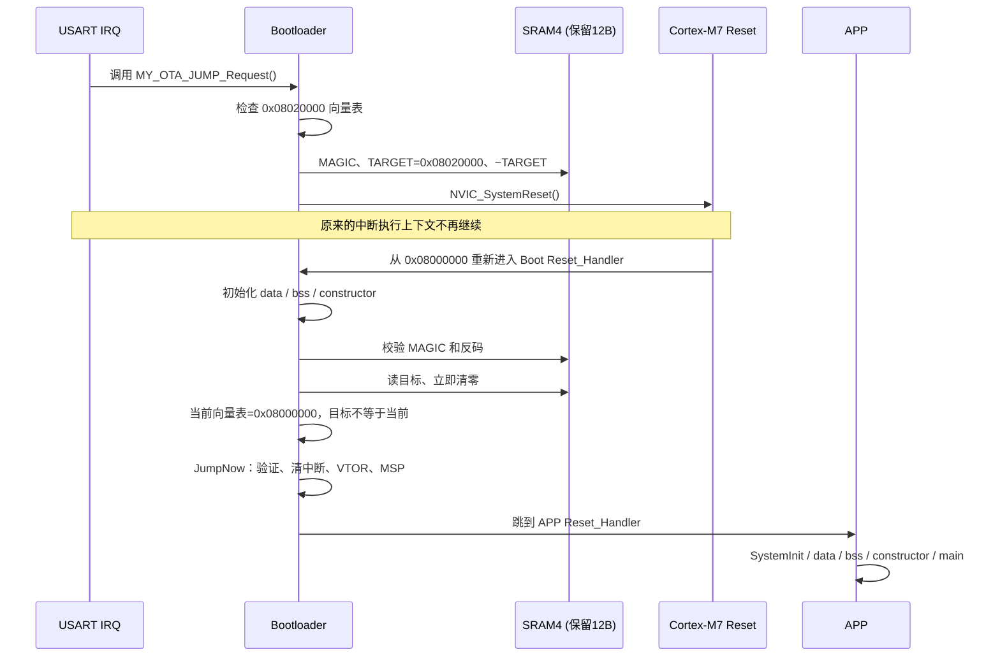

# 04 | Bootloader ↔ APP 的真实运行时序（最容易弄混的部分）

## 1. 初始前提

- 正常的 BOOT 配置选择主 Flash 的 `0x08000000` 启动。
- **Bootloader**：镜像向量表地址 `0x08000000`，编译的目标为 `0x08020000`，上界 `0x08080000`。
- **APP**：镜像向量表地址 `0x08020000`，编译的目标为 `0x08000000`，上界 `0x08020000`。
- 两工程都含原始 `MY_OTA_JUMP.c`，并使用与自身对应的头文件。
- 两工程 startup 都能执行 constructor（当前以 ST GCC 工程为例）。
- SRAM4 保留末尾 12 字节，启动流程不清零或覆盖它们。

## 2. 场景 A：上电，没有跳转请求

```text
上电 -> 硬件从 0x08000000 加载 MSP/PC
     -> Bootloader Reset_Handler
     -> 系统/运行时初始化
     -> constructor 检测 SRAM4：无有效 MAGIC
     -> Bootloader main()
```

**原代码没有“没升级请求就自动跳 APP”**。这是非常重要的真实行为！只有 Bootloader 主循环自己主动调用 `MY_OTA_JUMP_JumpNow()`，或出现有效 SRAM4 请求时，才可能跳到 APP。若希望量产设备“上电正常运行 APP”，应给 Bootloader 设计默认启动策略，如 300ms 进入升级窗口后尝试跳 APP；该策略是**后续设计，不在原代码中**。

## 3. 场景 B：在 Bootloader 串口 IRQ 中请求进入 APP



1. UART IRQ 调用 `Request()`。
2. 写入目标 APP 地址，并发出**软件复位**。
3. 复位后从 Bootloader 入口重新开始；**不是从 UART IRQ 返回**。
4. Bootloader `Reset_Handler` 到 `__libc_init_array` 时运行检查函数。
5. 发现目标为 APP，清掉标志，执行 Boot→APP 切换。
6. APP 的 `Reset_Handler` 自己初始化，并进入 APP 的 `main()`。

### 为什么要绕这一次软件复位？

UART ISR 位于 **Handler 模式**。Cortex-M7 的 Handler 使用 MSP，异常返回依赖 EXC_RETURN 和异常栈帧。此时直接修改 MSP 跳另一个工程会破坏异常现场管理。软件复位让 CPU 回到新的 Thread 模式启动环境，绕开从异常中强行转移的复杂风险。

## 4. 场景 C：APP 请求回 Bootloader

```text
APP 当前正在 0x08020000 运行
  ↓ 在 APP 中调用 MY_OTA_JUMP_Request()
APP 的配置 TARGET=0x08000000
  ↓ 写 MAGIC、TARGET、~TARGET
NVIC_SystemReset()
  ↓ 硬件从默认 0x08000000 启动
Bootloader 的 Reset_Handler → constructor
  ↓ 请求目标 0x08000000 与当前 g_pfnVectors 相同
清除一次性请求，直接返回 constructor
  ↓
Bootloader main()（不需要再跳一次）
```

**APP → Boot 的一侧与 Boot → APP 并不对称**：前者实际上只需系统复位就已经到了 Boot 起点；后者需要在 Boot 里额外软件跳到 `0x08020000`。所以你会在 constructor 里看到：

```c
if (requested_target == current_address) return;
```

这段不是无用代码，恰好用来处理“复位后已经到达目标”的情况。

## 5. 场景 D：APP 向量表非法

如果目标 `0x08020000` 前 8 字节没有有效 MSP/Reset_Handler，`MY_OTA_JUMP_IsApplicationValid()` 返回 0：

- 如果从 Bootloader 调用 `Request()`：**不发起复位，仍留在当前程序**。
- 如果 Bootloader constructor 处理请求时发现无效：请求已清空，`JumpNow()` 返回，继续走 Bootloader `main()`。
- 如果你在主循环里直接调用 `JumpNow()`：校验失败返回，不跳。

这是一种基础的“非法入口防护”，**不是固件完整性或安全启动验证**。

## 6. 场景 E：断电后再上电

SRAM4 的软件复位保留请求不应当被当作断电存储。如果整机断电，SRAM4 请求不保证保存；设备按 BOOT 配置启动。若想断电后仍记住“安装到第几包、是否完成、要不要回滚”，必须使用设计好的**非易失性元数据**（Flash 预留扇区、外部 NOR、EEPROM 等），并做断电一致性处理。

## 7. `main()` 前后与系统时钟的关系

当 `constructor` 运行时，C 运行时已完成部分初始化，但 HAL、UART、RTOS 未必初始化。所以此时适合做：读取启动标志、必要的小范围寄存器切换、决定哪个镜像启动；不适合：调用 `HAL_UART_Transmit` 等依赖已初始化句柄的 API，或者启动复杂 OTA 下载。

## 8. 最常见的误解

- **误解**：`NVIC_SystemReset()` 自动重启到 APP。**纠正**：依 BOOT 配置重启，APP 切换由后续 Boot 软件决定。
- **误解**：从 Bootloader 跳 APP 就要进 APP `main()`。**纠正**：应进 APP `Reset_Handler`。
- **误解**：设置 VTOR 后 APP 的所有外设都已正常。**纠正**：VTOR 只改变异常/中断入口，外设时钟、引脚、DMA 等仍须正确初始化。
- **误解**：constructor 一定可以跨工具链运行。**纠正**：必须核实启动文件/链接配置。
- **误解**：这两份文件已经支持自动在线升级。**纠正**：目前只负责选择和跳转，不负责下载、编程。
