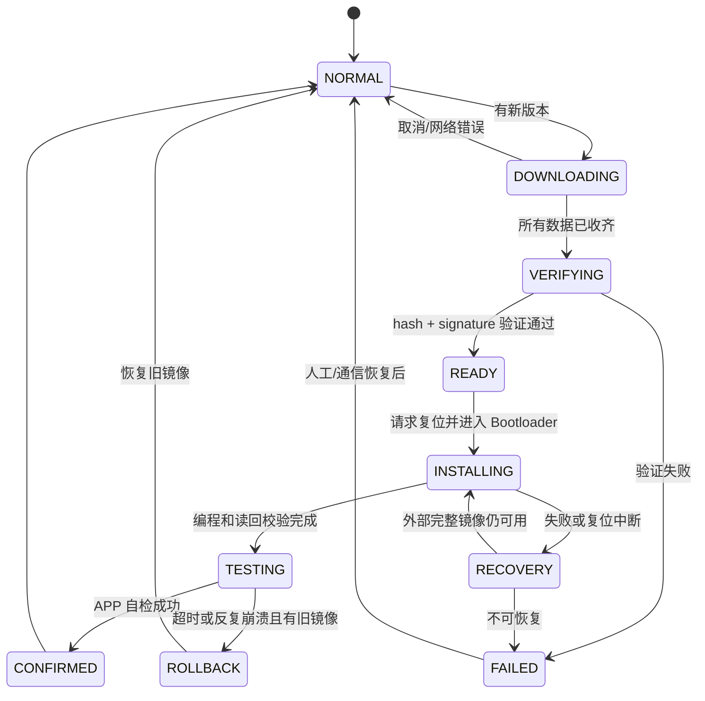

# 06 | 在现有跳转代码之上，怎样实现真正 IAP / OTA？

> 本文是**设计扩展**，不是对上传源码已实现功能的描述。上传源码仅提供软件复位请求和跳转机制，不包含下面的下载、擦除、编程和回滚流程。

## 1. 建议的整体架构

以你常用的 STM32H723 + ESP32 或网口方案为例：

```text
PC / 固件服务器
   │ firmware.bin + 版本信息 + Hash + 签名
   ▼
ESP32 / 以太网 / USB / UART
   │ 数据包 + seq + length + CRC + ACK / retry
   ▼
APP：升级接收任务（FreeRTOS 可选）
   │ 下载到外部 SPI NOR 暂存区（推荐的可靠方案）
   ▼
验证大小、设备型号、版本、SHA-256、数字签名
   │ 升级元数据写到非易失性区域
   ▼
APP 调用 MY_OTA_JUMP_Request() 返回 Bootloader
   │ NVIC_SystemReset(); SRAM4 请求用于角色切换
   ▼
Bootloader 安装：从暂存区读取新镜像 -> 分块擦写内部 APP 区
   │ 每块写入后检查；支持断电中断后重试安装
   ▼
检查新镜像，设置试运行状态，跳 APP Reset_Handler
   │ APP 自检 / 看门狗 / 通信 OK
   ▼
APP 确认升级成功；失败则恢复旧镜像或进入恢复模式
```

### 为什么建议 APP 下载、Bootloader 安装？

- 下载协议栈（Wi-Fi/TCP/TLS/HTTP/MQTT）复杂，放在 APP 中更好管理；
- Bootloader 可以尽量小，专注可靠安装与恢复；
- Bootloader 工作时不应依赖 FreeRTOS 大量任务正常运行；
- 安装阶段能控制 Flash 擦写流程，避免正常业务访问被擦掉的 APP 代码。

如果升级镜像只放在 ESP32 RAM 而没有稳定暂存位置，掉电之后可能失去安装来源；可靠系统应定义断电恢复策略。

## 2. IAP 详细流程（串口场景）

### 阶段 0：固件准备

- 把 APP 工程链接到正确运行地址 `0x08020000`；
- 输出 `firmware.bin`：该文件**不包含 ELF 文件头**，其前 8 字节应为 APP 向量表；
- 生成 manifest：设备型号 `STM32H723VE`、固件版本、大小、SHA-256、签名、发布序号等；
- 不允许发送超出 `[0x08020000, 0x08080000)` 的镜像，别让升级程序覆盖 Sector 0 的 Bootloader。

### 阶段 1：握手

```text
HOST -> MCU: START(version, size, hash, image_id)
MCU  -> HOST: READY(max_chunk, resume_offset)
```

检查是否为本设备型号、固件大小是否合理、是否具有足够的暂存存储容量。可选维护单调递增安全版本序号，避免降级。

### 阶段 2：分包下载

一个简单协议例子：

| 字段 | 类型 | 示例 | 用途 |
|---|---|---|---|
| SOF | 2B | `0x55AA` | 同步帧头 |
| CMD | 1B | `OTA_DATA` | 操作类型 |
| SEQ | 2B | `23` | 包序号 |
| OFFSET | 4B | `5888` | 镜像数据偏移 |
| LEN | 2B | `256` | 本包有效字节 |
| PAYLOAD | N B | 固件内容 | 二进制数据 |
| CRC32 | 4B | 计算值 | 检测传输误码 |

上表仅为**自定义参考协议**，不对应上传代码现有数据格式。推荐 CRC32 + 分包 ACK/NACK + 重传/超时。对于 UART DMA，完成中断中最好只是投递事件或缓冲，实际 Flash 写入和状态机运行放到任务/主循环，避免长时间阻塞 IRQ。

### 阶段 3：完整性与授权验证

下载完毕后验证：

- 实际字节数 = manifest 的固件长度；
- 所有包序号/偏移连续且无重复错位；
- SHA-256 匹配；
- 使用可信公钥验证数字签名；
- MCU 型号、硬件版本、固件版本和安全版本符合升级规则。

**CRC 只能用于无意错误检测，不能抵御恶意伪造；哈希只有配合可信签名或认证消息机制，才能证明升级包来源可信。**

### 阶段 4：持久化升级状态

至少设计：`state`, `version`, `image_size`, `image_hash`, `install_progress`, `retry_count`, `record_crc`、冗余/序号等，并将其记录在**非易失**的存储中；不要把 SRAM4 的 12 字节跳转请求当成 OTA 元数据。写状态记录要避免断电造成两份记录都损坏。

### 阶段 5：申请进入 Bootloader

APP 下载、校验后调用现有 `MY_OTA_JUMP_Request()`（注意 APP 配置目标 `0x08000000`）。它只是把控制权交回 Bootloader，不会替你安装新固件。

### 阶段 6：Bootloader 安装到内部 Flash

**STM32H723VE 的一个 Flash 扇区是 128 KiB**；擦除范围应该按镜像大小和 Flash 几何严格计算。H7 此系列 Flash 编程支持 256-bit（32 字节）Flash word 写入颗粒；应按 HAL 版本和 RM0468 确认接口、对齐、供电要求、ECC 和读回校验。

伪代码：

```c
bool install_image_from_external_flash(void)
{
    if (!verify_manifest_and_signature()) return false;
    if (!check_target_range_and_size())    return false;

    mark_state(INSTALLING);  // 非易失、具备掉电一致性

    for (each target_sector_overlapped_by_image) {
        if (!erase_whole_sector_safely()) return false;
    }

    for (offset = 0; offset < image_size; offset += FLASH_WORD_SIZE) {
        if (!read_staged_data_to_aligned_buffer()) return false;
        if (!program_and_verify_flash_word())    return false;
        mark_resume_progress_if_necessary();
    }

    if (!verify_installed_image_again()) return false;
    mark_state(TESTING);
    return true;
}
```

**这是架构伪代码，不是可编译的 HAL Flash 编程函数。** 特别注意：如果采用“先擦完所有扇区，再写入”的方式，安装中途断电后旧 APP 已不完整。要能恢复，必须保留可靠的镜像暂存区，并在下次启动时支持重试整个安装或合理的分段恢复。

### 阶段 7：新 APP 试运行与确认

Bootloader 判断已安装镜像有效后跳 APP。APP 在限定条件下完成关键初始化和自检，然后写入 `CONFIRMED` 状态。如果看门狗连续复位、新固件无法正常确认，则：

- 保留了**完整旧镜像备份**：Bootloader 可恢复旧固件；
- 没有旧镜像备份，但有完整新镜像暂存：可重试新固件安装；
- 都没有：只能进入恢复下载模式，不能宣称“自动回滚”。

## 3. OTA 和 IAP 的真正差异

| 问题 | IAP 视角 | OTA 视角 |
|---|---|---|
| 新固件从哪来 | UART / USB / CAN / Flash 等 | 无线服务器/ESP32 等 |
| 如何防数据丢失 | 分包 CRC、ACK、重试 | 网络重试、断点续传、TLS 等 |
| 谁擦写 MCU Flash | Bootloader 或 APP 的 IAP 逻辑 | 仍需要设备端安装逻辑 |
| 如何管理版本 | manifest / 元数据 | 还需云端发布策略/版本检查 |
| 如何恢复掉电 | 镜像暂存、事务化状态 | 同样必须实现，OTA 本身不会自动解决 |

## 4. 512 KiB H723VE 的分区约束

现有 Boot 128 KiB + APP 384 KiB 已经占满全部 512 KiB 内部 Flash：

- 想保留一个**完整 384 KiB 的新 APP 镜像**，内部 Flash 空间不够；
- 想同时保留完整新镜像和旧镜像用于掉电回滚，需进一步评估外部 Flash 容量；
- 两个镜像若链接到不同地址，**不能直接把同一份绝对链接的 `.bin` 当成可在任意 A/B 槽启动**；
- 如果确定需要可靠恢复，推荐预留外部 QSPI/SPI NOR 暂存与备份，运行地址仍固定 `0x08020000`，由 Bootloader 从外部复制安装。

## 5. 建议的 OTA 元数据状态机



## 6. 实战验收项目

1. 完整镜像、错误镜像、CRC 失败、签名错误均有正确响应。
2. Flash 目标地址严格限制在 APP 范围；Bootloader 扇区永不被误擦。
3. 在**每个关键步骤**切断电源都能给出可预测结果：继续安装、恢复旧版本或进入安全恢复模式。
4. 新 APP 首次启动失败，不应无限重启并覆盖最后的有效镜像。
5. 网络失联不应让已运行的旧 APP 不可用。
6. 更新日志包含设备型号、目标版本、时间、结果和失败码，但绝不把签名私钥放在设备里。
