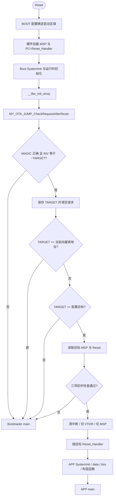
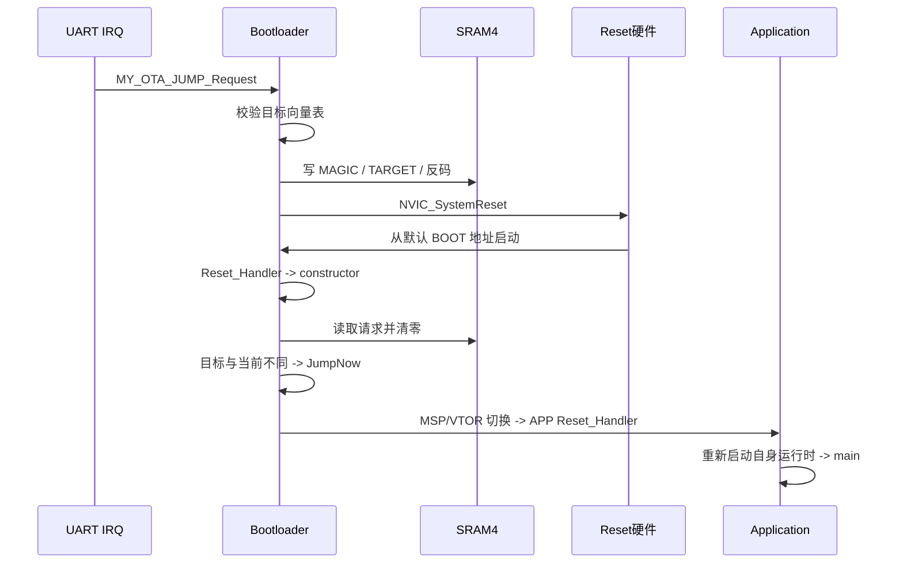
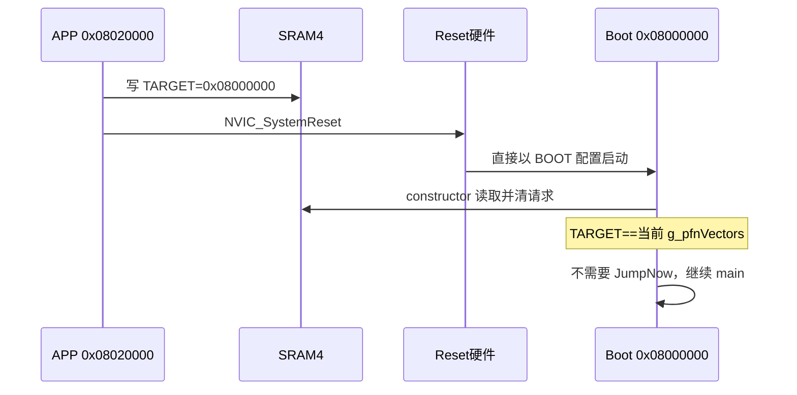
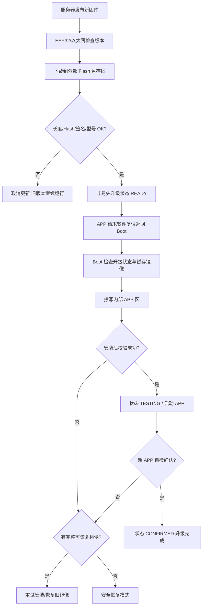
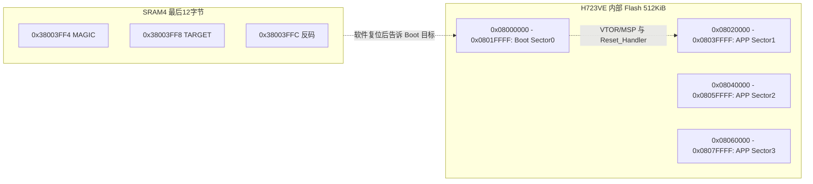

# 11 | GitHub Mermaid 图：启动、切换、升级、故障分支

## 图 A：从复位到 APP main（原代码对应）

## 图 B：UART IRQ 请求进入 APP（原代码对应）

## 图 C：APP 返回 Boot（原代码对应）

## 图 D：完整 OTA 设计扩展（并非上传代码已实现）

## 图 E：关键存储器关系

> 如果在非 GitHub Markdown 阅读器看不到 Mermaid，可直接参阅前几章中的文本箭头流程。VS Code 中可安装 Markdown Mermaid 预览插件。
