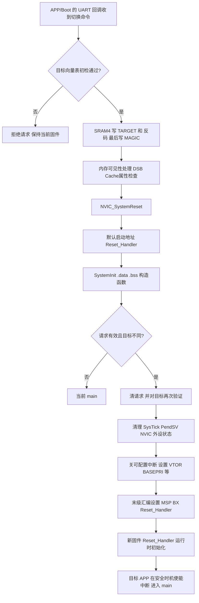

# 13｜VTOR / CONTROL / MSP / BX 之前到底要满足哪些条件？

> 本章回答你连续追问的核心：**“做这些操作之前，CPU 必须是什么状态，内存必须是什么状态？”** 每个检查点都给出“失败会怎样”和“如何查”。不是把“调用几个 CMSIS 函数”当作跳转正确性的证明。

## 1. 先把“硬性必要条件”与“项目安全条件”分开

- **体系结构要求**：写受特权保护的寄存器需要特权；通过异常/中断模型正确进入/退出模式；Thumb 分支入口 bit0；栈不能越界；某些控制寄存器改变后要执行 ISB。
- **Bootloader 协议要求**：目标代码的链接地址、向量表、Reset_Handler 和实际 Flash 内容一致；没有依赖旧 RTOS 状态；管理 PRIMASK/BASEPRI、异常挂起状态。
- **工程性建议**：镜像的数字签名、版本回滚、外设退出、看门狗、MPU、Cache、日志、安全 OTA 原子性。不是 CPU 每次 `BX` 的硬件条件，但缺失会导致产品故障。

## 2. 为什么“当前模式”要先检查？

```c
uint32_t ipsr = __get_IPSR();
uint32_t control = __get_CONTROL();
```

| 条件 | 如何判定 | 如果不满足 |
|---|---|---|
| **Thread Mode** | `IPSR == 0` | 处在 ISR/异常内修改栈、向量后，异常活动状态不能靠普通分支退出 |
| **特权级** | Thread 下 `CONTROL.nPRIV == 0` | 无法按预期访问特权控制状态 |
| **Thread 当前使用 MSP** | `CONTROL.SPSEL == 0` | 执行中的 C 函数可能还在 PSP 栈上，直接换 MSP 无法安全迁移旧帧 |
| **没有仍需恢复的任务状态** | 由程序设计保证 | FreeRTOS 旧任务被弃用，不能后续 return 到原调用者 |

**例外提醒：**能在 Handler Mode 写 MSP ≠ 允许在 UART IRQ 内直接 `BX` 到 APP。后者会留下活动异常现场，且 CPU 仍处于 Handler Mode；`BX` 不是异常返回。

你的上传方案先 `NVIC_SystemReset()`，让处理器重新走启动流程，**旨在**使最终切换执行于普通启动上下文；但要验证具体启动链路、链接位置和初始化代码，而不是仅凭注释断言安全。

## 3. APP 存储方面的先决条件

```c
uint32_t initial_msp = *(volatile const uint32_t *)(APP_BASE + 0);
uint32_t reset_pc    = *(volatile const uint32_t *)(APP_BASE + 4);
```

1. `APP_BASE` 是可访问且已烧录的向量表实际地址，**不是 Bootloader 自己的地址**。
2. APP **必须按该地址链接**，不是只用烧录器把同一 `.bin` 随意搬家。
3. 向量表对齐必须满足目标 Cortex-M7 的向量数量要求。理论最小要求不等于 MCU 具体所需；`0x08000000` 和 `0x08020000` 两个地址都满足通常的高对齐要求。
4. `initial_msp` 必须 8 字节对齐、指向真实可用 RAM 的栈顶（可等于内存区域**开区间末地址**，但不能等于区域起点）。
5. `(reset_pc & 1) == 1` 且 `reset_pc & ~1` 位于该目标固件的合法可执行区域。
6. 上述只能称为**向量表合理性检查**；实际固件可被篡改/损坏。上线前还要哈希与签名校验。
7. 如果栈顶在 DTCM/AXI/SRAM4 等区域，目标启动前该 RAM 必须可访问且其电源/时钟/MPU 配置适用。

## 4. 切 VTOR 前的检查与影响

`SCB->VTOR = APP_BASE;` 只是改变**异常/中断向量查表起点**，不自动重新加载 MSP，不立即执行新 PC，不重新配置 UART，不清除挂起中断。

| 影响 | 处理策略 |
|---|---|
| 旧 SysTick 还在触发 | `SysTick->CTRL=0` 并清其 Pending |
| PendSV 已挂起 | 清 ICSR 的 PENDSVCLR；检查任务调度是否退出 |
| 某 NVIC IRQ 已使能/挂起 | 按芯片实现的 NVIC bank 数量逐组禁用/清 Pending |
| 外设 IRQ 标志仍存在 | 关闭外设中断源并清设备级 pending 状态 |
| DMA 仍在访问旧缓冲区 | 先停 DMA，避免破坏 APP 初始化数据 |
| 系统正在执行中断处理函数 | **不要把 `BX Reset_Handler` 当作退出 ISR**；先通过软件复位回到 Thread 初始化路径 |

**注意：**`__disable_irq()` 设置 PRIMASK，会屏蔽普通可配置中断，**不能屏蔽 NMI**；`NVIC->ICER` 只关外部 IRQ，使能/挂起处理不等于停止硬件外设。系统故障异常等另有机制。

## 5. 改 CONTROL 前的检查

`__set_CONTROL(0)` 试图让 Thread Mode 处于**特权 + MSP + 非活动 FP 上下文**。

- 当前必须具有足够权限；Thread 非特权不能用它“自动提升权限”。
- 需要 ISB 确保后续指令按新控制状态执行；不要先在普通 C 函数内部一半还靠 PSP 的时候直接把 SPSEL 从 1 改成 0。
- 仅在**已知普通启动路径**（如复位后 constructor/Bootloader early main，原本就 Thread+MSP）做简单切换。RTOS 任务从 PSP 跳入请优先走“记录请求→软件复位”。
- 启用 FPU 的项目要注意 FPCA、惰性压栈和旧异常状态。

## 6. 改 MSP 前的检查

```asm
msr msp, r0
bx  r1
```

必须确定：

1. R0 是 APP 栈顶；R1 是正确 Thumb 入口值。
2. 该汇编位于**不使用栈、不会返回**的末级分支例程中，不能在下一行继续执行依赖原 C 栈帧的代码。
3. 此时必须不会被旧上下文的普通中断打断；推荐切换期间保持 `PRIMASK=1`，由 APP 在合适时刻显式启用。
4. 目标 Reset_Handler 必须能在新的 MSP 下运行，并能按自己的链接脚本完成 `.data/.bss` 和构造函数初始化。
5. APP 初始时 PRIMASK 可能仍是 1——**直接跳转不是硬件复位**，PRIMASK 不会自动归零。若 APP 依赖 HAL tick，需在其初始化过程妥善解除屏蔽。

## 7. BASEPRI、FAULTMASK 和原代码需要补齐的状态

| 寄存器 | 核心含义 | 跳转说明 |
|---|---|---|
| `PRIMASK` | 屏蔽普通可配置异常 | `__disable_irq()` 后通常仍为 1，需要 APP 重新开启 |
| `BASEPRI` | 优先级阈值屏蔽部分异常 | FreeRTOS 临界区可能使其非 0，复位后一般重新初始化 |
| `FAULTMASK` | 更广范围的异常屏蔽（NMI 例外） | 正常复位启动不应带入旧非正常屏蔽状态 |
| `CONTROL` | 特权、栈选择、浮点活动状态 | 需要与当前执行模式和 ABI 匹配 |
| `IPSR` | 当前异常号 | 检查是否仍在 ISR/异常里 |
| `VTOR` | 异常向量查表基址 | APP 地址、对齐、映射要正确 |

并非所有示例都要机械地把上述寄存器全部写 0。特别是 fault/MPU/Cache 处理要基于你使用的启动模型和系统安全要求；**必须知道自己重置了什么、目标代码依赖什么**。

## 8. 推荐顺序：复位后主动跳 APP（针对你的工程）



> 这张图是**加固设计流程**，不是声称上传代码已经包含所有环节。上传代码实际少了多项状态/资源处理。

## 9. 为什么不能在 FreeRTOS 任务里直接先关调度，再换 MSP？

`vTaskSuspendAll()` 只暂停任务调度，不让线程自动转成 MSP，也不会清除已经活动的中断和外设，也不保证所有用户代码可重入。`taskENTER_CRITICAL()` 管理中断屏蔽规则，仍然运行在当前任务栈。`NVIC_SystemReset()` 更适合用于退出已经运行中的 FreeRTOS 系统。

## 10. 排错：发生 HardFault 先查什么

| 表现 | 最先查 |
|---|---|
| `BX` 立刻 HardFault | 入口 bit0、地址、Flash 是否为有效代码、MPU 执行权限 |
| APP 启动后变量乱 | `.data/.bss` 的启动脚本、链接地址、栈/Heap 重叠 |
| APP 串口中断异常 | VTOR 设置被 SystemInit 覆盖、旧 pending、外设初始化顺序 |
| APP `HAL_Delay` 卡死 | PRIMASK 未重新启用、SysTick 未正常开启 |
| 复位后找不到 SRAM4 请求 | 链接器碰撞、`.bss` 覆盖、Cache、RAM 保持路径 |
| Debugger 一跳就停在 UsageFault | Thumb 位、INVSTATE/UNDEFINSTR 位、stack alignment |

参考：[12 函数指针](12_函数指针_BX_BLX与PC.md)、[14 RTOS 保存](14_FreeRTOS_PendSV_现场保存条件.md)、[18 实机调试](18_寄存器观测_实机调试.md)。
