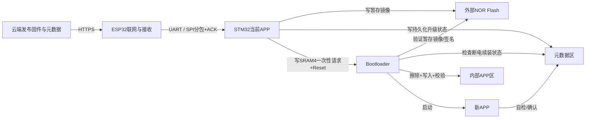
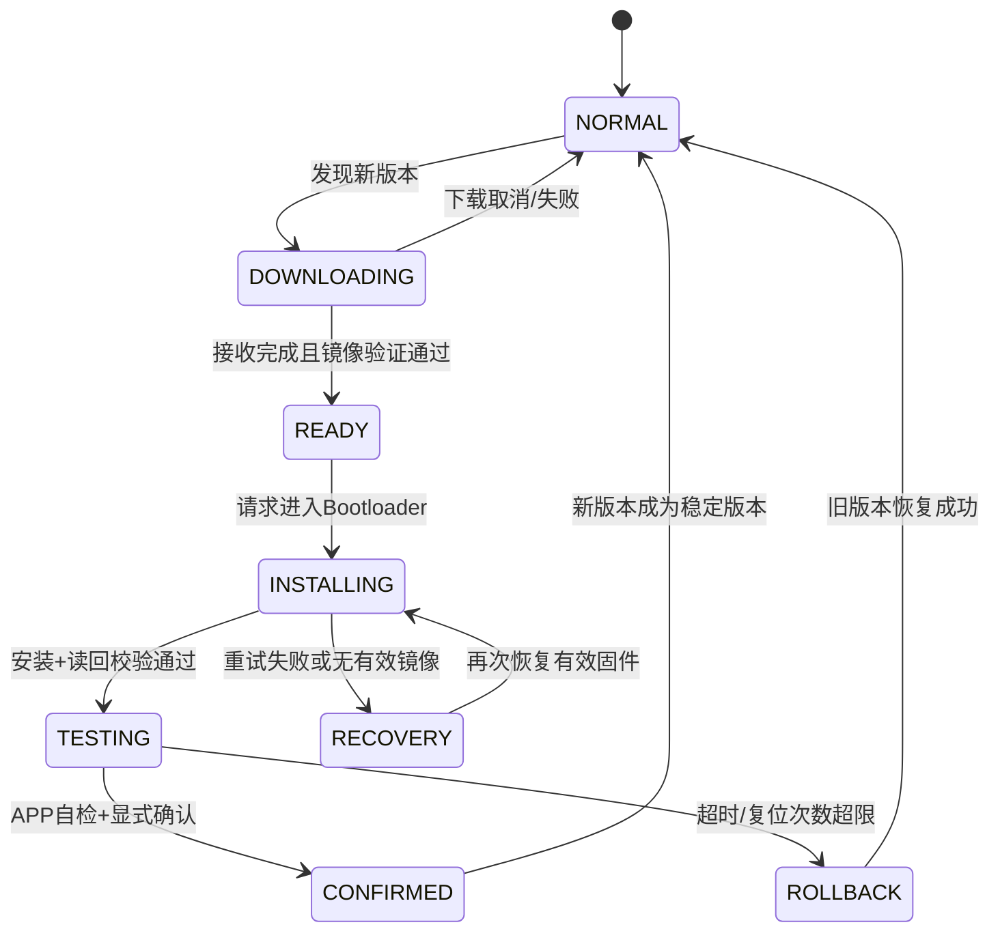

# 17｜真正的 IAP / OTA：固件下载、安装、掉电恢复和安全回滚（详细设计）

> **本章属于方案扩展，不是上传 `MY_OTA_JUMP.c/.h` 已有功能。** 原代码只做“请求重启 + 跳转”，并没有 `HAL_FLASHEx_Erase`、`HAL_FLASH_Program`、UART 分包、OTA 服务器或事务日志。

## 1. 三者是什么关系？

- Bootloader：一段在复位后运行的程序，负责选择/验证/安装/启动其他镜像。
- IAP（In-Application Programming）：设备利用自己正在运行的固件对其 Flash 进行编程的能力。
- OTA（Over-The-Air）：固件通过无线链路传到设备的机制（ESP32 Wi-Fi、4G 等）。

不是“有跳转函数=有 OTA”，也不是“只有 Bootloader 能进行 IAP”；架构可以让 APP 在运行中下载，Bootloader 在下次复位后安装。

## 2. 以 STM32H723VE + ESP32 为例的模块分工



选择外部 NOR Flash 是**建议**而非硬性要求；也可选择内部独立暂存区域，但 H723VE 只有 512 KiB、以 128 KiB 为扇区，容量分配需要重新估算。若 APP 需要 300 KiB，内置 Flash 通常不能再容纳同样大小的一份完整镜像及大量其他数据。

## 3. 分阶段完整 OTA 流程（每一步的输入/输出）

### 阶段 A：构建发布固件（PC）

**输入**：新 APP 的源代码、链接脚本、目标 STM32 型号。**输出**：`firmware.bin` + manifest（清单）。

manifest 示例（**这是协议设计示意，不是原代码数据结构**）：

```json
{
  "device_model": "stm32h723ve_demo",
  "app_link_address": "0x08020000",
  "version": "1.2.0",
  "image_size": 131072,
  "sha256": "<发布时计算的SHA-256十六进制摘要>",
  "signature": "<发布服务私钥生成的数字签名>",
  "min_boot_version": "1.0.0"
}
```

有一个关键点：`image_size`、固件基地址与 APP 实际编译链接配置要一致；签名覆盖的元数据范围要固定规范（字段编码、字节序、算法、版本），否则接收端无法可靠验证。

### 阶段 B：联网与版本检查（ESP32/APP）

**检查**：设备型号、当前固件版本、服务器可信性、升级策略、可用空间、电源状态。HTTPS 保护传输过程；固件签名验证仍有独立价值，因为链路安全和固件来源完整性是两个不同层次。

### 阶段 C：分包接收（APP/Bootloader）

建议包字段（尺寸仅为示例）：

```text
SOF (2B)
CMD (1B)
SESSION_ID (4B)
SEQ (4B)
OFFSET (4B)
DATA_LEN (2B)
PAYLOAD (0..256B)
CRC32 (4B)
```

接收规则：

1. 校验长度边界，禁止 `OFFSET+DATA_LEN` 超出镜像声明大小；
2. 先按 `SESSION_ID` 区分不同下载任务；
3. 检验 CRC，拒绝损坏包；
4. 检查包序号、偏移和重传的幂等性；
5. 暂存写入完成并确认后再 ACK，不要“收到串口 DMA 数据就假装持久化”；
6. 定期上报进度，可以断线续传（按持久化偏移/bitmap）；
7. 全包收齐后进入镜像整体校验。

### 阶段 D：验证镜像完整性和授权

验证层次从弱到强：

| 层次 | 检查什么 | 能否防恶意篡改 |
|---|---|---|
| 向量表初检 | MSP、Reset 入口落在允许范围，Thumb 位 | 不能 |
| CRC32 | 偶发传输/存储错误 | 不能 |
| SHA-256 | 内容与清单摘要一致 | 清单不可信时仍不能 |
| 数字签名 | 清单和镜像由受信密钥授权 | 可以提供来源认证与完整性保证（取决于密钥管理） |
| 防回滚版本/计数器 | 拒绝不安全的旧固件 | 取决于可信存储/安全策略 |

不能用 `MAGIC=JUMP` 当作签名，也不能用 `TARGET_INV=~TARGET` 当作安全校验。

### 阶段 E：安全记录升级状态

推荐设计两个可替换的持久化状态槽位（或日志结构），选择**校验通过且序号较新**的一份状态，避免一次写入中掉电造成唯一状态损坏：

```text
metadata record:
  sequence, state, image_version, image_length, image_hash
  install_checkpoint, trial_count, confirmed_version, record_crc
```

状态机：



### 阶段 F：升级请求与软件复位

这一步才与当前 `MY_OTA_JUMP_Request()` 思路衔接：

1. APP 已把新镜像放在**掉电不丢的暂存区**；
2. APP 已记录 `READY` 的持久化事务；
3. SRAM4 写一次性“进入 Bootloader 处理升级请求”的信息；
4. `NVIC_SystemReset()`；
5. Bootloader 按持久化元数据检查并执行安装，而不是只因 SRAM4 魔数就擦 Flash。

**重要边界**：原有 `Request()` 实际只把固定的“另一端镜像地址”写进 SRAM4，并不知道 `READY` 状态或固件安装动作。这里需要额外设计升级状态协议。

### 阶段 G：Bootloader 擦除并安装

安全顺序：

```text
检查签名/型号/长度/版本/暂存区完整性
  ↓
标记 INSTALLING（持久化）
  ↓
按 APP 的内部 Flash Sector 边界擦除
  ↓
按 STM32H7 的 Flash 编程粒度写入新镜像
  ↓
逐块读回检查，最终完整镜像校验
  ↓
标记 TESTING，记录新版本/试运行次数
  ↓
跳转 APP Reset_Handler
```

**H723VE 硬件约束**：512 KiB 有效 Flash 通常为 4 个 128 KiB Sector，不能复制 F407 的 `FLASH_TYPEPROGRAM_WORD` 例子。H7 Flash 编程涉及 Flash word、ECC、写入电压、擦除状态、cache 一致性；移植以你当前 HAL 版本和 RM0468 为准。

### 阶段 H：新 APP 自检确认

新 APP 可在规定窗口内完成基本自检：中断、系统时钟、关键任务、通信外设、必要的传感器/应用服务。确认后再持久化为 `CONFIRMED`。不要在 `main()` 一进来就提前确认，否则“会进 main 但业务启动不了”的固件无法自动回滚。

## 4. 内部 Flash 的容量算例（很重要）

H723VE 512 KiB 四个 128 KiB Sector：

| 区域 | 地址 | 大小 | 用法示例 |
|---|---|---:|---|
| Sector0 | `0x08000000–0x0801FFFF` | 128 KiB | Bootloader |
| Sector1 | `0x08020000–0x0803FFFF` | 128 KiB | APP 首扇区 |
| Sector2 | `0x08040000–0x0805FFFF` | 128 KiB | APP 继续 |
| Sector3 | `0x08060000–0x0807FFFF` | 128 KiB | APP 继续 |

- 如果 APP 大于 128 KiB，直接 A/B 双槽（两份大小相同的 APP）在这 512 KiB 内很可能无法满足容量；
- 如果需要旧版可恢复，必须有仍可用的旧镜像或固定恢复包（可能在外部 NOR Flash）；
- 把新固件直接覆盖到运行中的 APP 所在扇区、没有暂存和回滚设计，掉电就可能失去可运行 APP。

## 5. 真正“可回滚”需要满足什么条件？

**A/B 并不等于自动回滚，双镜像存在也不等于可直接运行**：

- Slot A 和 Slot B 若使用不同的链接地址，固件必须按相应入口链接，或者实现重定位/复制到固定运行地址；
- 必须有明确的“试运行待确认”状态与失败计数；
- 系统启动入口始终可信且不会被升级过程擦除；
- 掉电前、安装中、重启后每种状态都要有确定的恢复路径；
- **任何时刻**应存在至少一个可验证的恢复镜像或可靠再下载机制。

## 6. 典型断电点与恢复策略

| 掉电点 | 再次上电状态 | 应采取的操作 |
|---|---|---|
| 下载 30% | DOWNLOADING | 已持久化的块可断点续传 |
| 签名验证前 | DOWNLOADING | 不允许安装未校验镜像 |
| 写 READY 状态中 | 旧元数据有效 | 取有效的冗余记录，必要时重新验证 |
| Boot 擦除 APP 第 2 个扇区 | INSTALLING | 使用**完整暂存镜像**重新安装或恢复旧镜像 |
| 安装完读回校验失败 | INSTALLING/RECOVERY | 保持 Bootloader 可用；重试/修复，不进入坏 APP |
| 首次启动后看门狗复位 | TESTING | 递增失败次数，达到门槛执行回滚 |
| 自检确认后正常运行 | CONFIRMED | 下一次启动进入正常稳定版本 |

## 7. 默认 Bootloader 启动策略伪代码

```c
/* PSEUDOCODE ONLY：不是已经实现的 STM32 HAL 工程 */
void boot_main(void)
{
    boot_metadata_t m = load_latest_valid_metadata();

    if (m.state == INSTALLING || m.state == READY) {
        if (validate_staged_image() && resume_or_install()) {
            save_state(TESTING);
        } else {
            enter_recovery_mode();
        }
    }

    if (m.state == TESTING && trial_limit_exceeded()) {
        if (!restore_verified_previous_image()) {
            enter_recovery_mode();
        }
    }

    if (verify_installed_image() && boot_policy_allows_it()) {
        branch_to_app_safely();
    }
    enter_recovery_mode();
}
```

源码没有实现这些函数；它们描述的是**需要你补充的功能边界**，不要直接复制烧录。

## 8. 从零实现的最小实战顺序

1. 双工程 + LED 验证启动方向（不擦 Flash）。
2. UART 固定小分包写到**指定外部暂存区**，实现长度、offset/ACK/retry。
3. 独立完成镜像签名/摘要验证。
4. Bootloader 仅安装一份已验证 `.bin` 到固定 APP 地址，完整读回验证。
5. 加入持久化安装进度和恢复镜像。
6. 加入测试确认、异常回滚、故障注入。
7. 最后再上 ESP32 网络下载、服务端发布/版本策略。

## 9. 不应宣称完成的内容

本仓库没有设备私钥、安全启动链、生产级 Flash 驱动、实机断电验收；所以不能把这里的流程图当作“已完成稳定 OTA”的实证。这一点在 GitHub 主页与代码例子中都应保持清晰。
